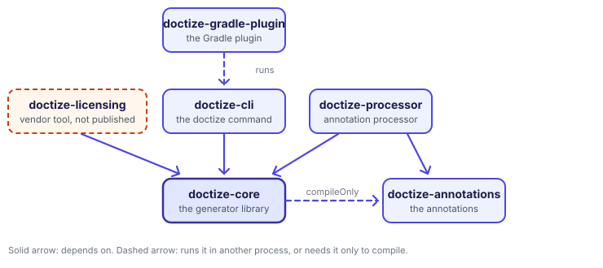
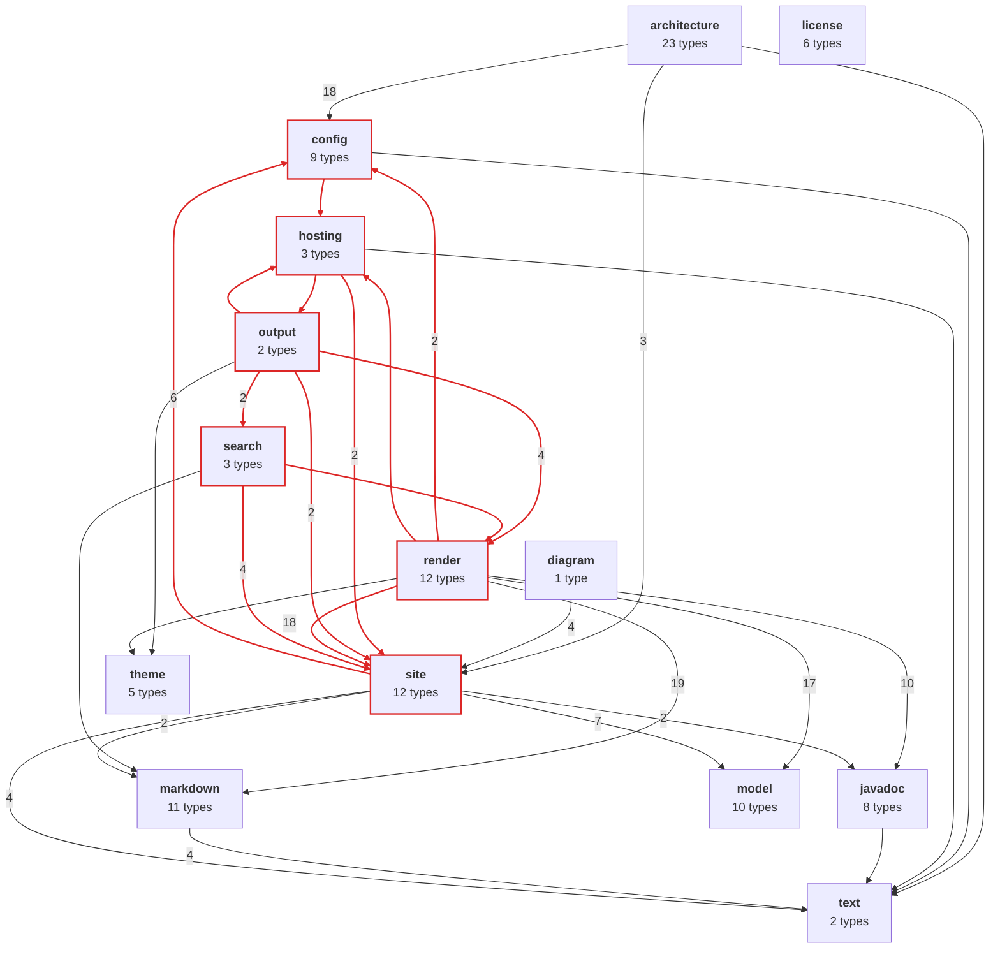

# Architecture of Doctize

This page is for people who change Doctize or build on it. [How it works](../guides/07-how-it-works.md) follows a page through the
pipeline; this one looks at how the code is put together: which modules there are, which packages the generator consists
of, who may depend on whom, and where that is not (yet) true.

The facts here come from the same analysis that the [architecture diagrams](../guides/08-architecture-diagrams.md) make, and a test keeps them true:
it analyzes the code of Doctize and fails if the table and the diagram of the packages below say something else than the code does. When this
site is built with a [license](../setup/06-licensing.md), this section, *Architecture*, also contains the diagrams of the current code:
*Package overview*, *Class diagrams* and *Flows*.

## Modules

| Module | Published | Depends on | What it is |
|--------|-----------|------------|------------|
| `doctize-annotations` | yes | nothing | The annotations of documented code: {@link Doc}, {@link DocPage} and {@link DocIgnore}, which have source retention and leave no trace in class files, and the ones that mark code for the [architecture diagrams](../guides/08-architecture-diagrams.md), such as {@link DiagramIgnore} and {@link Flow}, which are kept in class files. |
| `doctize-core` | yes | Jackson, commonmark, jmustache; the annotations only to compile | The generator: everything from the Javadoc parser to the theme engine, the licensing and the architecture diagrams. Entry point {@link Doctize}. It also carries the Mermaid library that draws diagrams, as a file. |
| `doctize-processor` | yes | annotations, core | The annotation processor. It runs inside `javac` and writes `model.json`. |
| `doctize-cli` | yes | core, picocli | The `doctize` command. |
| `doctize-gradle-plugin` | yes | Gradle's API only | The plugin `dev.doctize`. It runs the command line tool in a separate process. |
| `doctize-licensing` | **no** | core, picocli | The vendor's tool that creates the signing key and issues licenses. |
| `doctize-docs`, `doctize-example` | no | see below | Documentation built by Doctize: this site, and the site of a small sample library. |
| `doctize-tests` | no | all of the above | Integration and system tests. |

A few of these dependencies are choices, and the reasons are worth knowing before changing them:

- **The plugin does not depend on core.** Gradle runs on JDK 17 or newer, the generator needs Java 25. So the plugin is compiled for
  Java 17 and runs the command line tool as a process on a Java 25 toolchain. The only thing it shares with the tool is the
  command line, which is one class (`CliArguments`).
- **The annotations are not a dependency of core at run time.** Core needs {@link Doc} to document itself, which is what
  `doctize-docs` does: it compiles the sources of the annotations and of core a second time with the processor switched on. Because
  the processor depends on core, it cannot run while core is compiled. The annotations for the diagrams are read from class files *by
  name*, so core never loads them either.
- **The processor writes, the generator reads.** They meet only in `model.json`, a versioned file, described by {@link SourceModel}. That is
  why the processor keeps the raw doc comment, and why Javadoc and Markdown handling can be improved without recompiling
  anyone's code.
- **The diagrams are made from class files, not from source.** They see what the compiler saw, work for any module or jar, and need
  neither the processor nor a second compilation. That is why the marker annotations are kept in the class file, and why they take text
  and no enum: an enum constant in a library would make every project that uses the library without Doctize see a compiler warning.
- **Diagrams are drawn in the browser.** Doctize writes the Mermaid text of a diagram into the page, and `diagrams.js` of the theme loads the
  Mermaid library, which is large, only on pages that have a diagram; the library is copied into a site only if a page needs it. The site
  stays static and offline, and the text of a diagram stays in the page. The price is a script; the overview can also be drawn as an SVG that
  Doctize makes itself and that needs none.
- **Licensing is split in two.** Core has the public key and can *check* licenses. Issuing them needs the private key and is in
  `doctize-licensing`, which no published module depends on, so that no code that can sign is shipped to users. Whether a Pro feature may be
  used is decided in one place, in {@link Doctize}, and a feature that is denied is skipped with a warning, never an error.

## Inside doctize-core

The generator is one module with these packages under `dev.doctize`. The package `dev.doctize` itself holds the entry point
{@link Doctize}, the {@link GenerationReport} and the {@link DoctizeException} that every package throws. Because so many packages
refer to that exception, and the entry point refers to almost all of them, the root package is left out of the map and of the table
below: it would be a hub that hides the structure.

The arrows point from a package to the packages it depends on, and red marks [the cycle](#the-cycle). The diagram is what
`doctize generate --classes doctize-core/build/classes/java/main --diagram overview` makes with `rootPackage: dev.doctize` and the root
package excluded. The table says the same in words:

| Package | What it does | Depends on |
|---------|--------------|------------|
| `text` | Escaping and slugs, the bottom of the code | nothing |
| `model` | The model the processor writes and the generator reads | nothing |
| `license` | Licenses, their verification and the search for them | nothing |
| `theme` | The theme as a stack of layers, and the Mustache template engine | nothing |
| `javadoc` | Parses doc comments, resolves `{@link}` and other inline tags | `text` |
| `markdown` | Markdown to HTML, heading anchors, build-time syntax highlighting | `text` |
| `config` | The settings of `doctize.yml` | `hosting`, `text` |
| `site` | Page sources, and the assembler that puts pages into sections and gives them URLs | `config`, `javadoc`, `markdown`, `model`, `text` |
| `architecture` | The architecture diagrams: a page source that analyzes class files and draws Mermaid diagrams | `config`, `site`, `text` |
| `diagram` | The Mermaid library that draws diagrams in the browser, and which pages need it | `site` |
| `render` | Renders a page: guides through Markdown, types through their template | `config`, `hosting`, `javadoc`, `markdown`, `model`, `site`, `theme` |
| `search` | Builds the search index | `markdown`, `render`, `site` |
| `hosting` | The address of the site, and the files GitHub Pages needs | `output`, `site`, `text` |
| `output` | Writes the site: the pages, the assets and the index | `hosting`, `render`, `search`, `site`, `theme` |

Read from the top, this is the pipeline from [How it works](../guides/07-how-it-works.md) turned into a structure: a foundation
without dependencies, languages built on it (`javadoc`, `markdown`), the structure of the site (`config`, `site`), the features that
plug into it (`architecture`, `diagram`, and the API and guide sources inside `site`), and the output side (`render`, `search`, `hosting`,
`output`).

### Rules that hold

- **`text`, `model` and `license` depend on no other package** of Doctize, apart from the exception in the root package. They
  are the parts that others build on, or that are read on their own: the model is the contract between two modules, and licensing
  is small enough to be read and audited on its own.
- **The annotations stay dependency-free.** The jar has nothing but annotations, and the names of the kinds of diagram, and is tiny.
- **Core has no dependency on another Doctize module** in its published metadata, and the command line tool has none on the
  licensing tool.
- **Nothing in a page source knows the theme.** A {@link PageSource} returns {@link Page}s that say *what* they want, not where they
  end up or how they look. The assembler is the only place that decides structure, which is why this site's architecture page could
  be added without touching the renderer: it is a page source that produces Markdown.

These rules are checked, not only written down. A test analyzes Doctize with its own architecture diagrams and fails if the first rule is
broken, the release tests inspect the published artifacts for the others, and the same rules are declared in `doctize.yml` of this site, so a
licensed build reports a violation as a warning.

The table and the diagram above are checked as well: the same test compares them with what the analysis finds, package by package and
arrow by arrow. If you move a dependency, the build tells you which line of this page to change.

### The cycle

The rules above are about the bottom of the code. The middle is not clean: **`config`, `hosting`, `output`, `render`, `search` and
`site` depend on each other**, directly or through one another; they are the red packages of the diagram. The live overview of this site does
not report it as a warning, because the build of the documentation fails on warnings, and this would be one. It comes from three chains:

- `config` → `hosting` → `site` → `config`: the settings of the site (`config`) contain the hosting settings, the code that writes
  the hosting files needs the assembled site, and the assembler reads the settings.
- `hosting` → `output` → `hosting`: the writer of the site needs the address of the site, and the hosting files are written
  through the output directory.
- `output` → `search` → `render` → `hosting` → `output`: the writer writes the search index, which is built from rendered
  pages, whose layout needs the address of the site for canonical links.

It costs little today, since all six packages are in one module, released together. It does mean that none of them can be understood, tested or changed
on its own. What would untangle it is a matter of moving types, not of redesign: settings records next to `config`, whatever writes files next
to `output`, and `hosting` reduced to the address. This is a description of the cycle, not a plan; the map exists to make such things visible.

## Where to extend

| To... | Implement or use | Guide |
|-------|------------------|-------|
| add pages from any source | {@link PageSource}, registered with `Doctize.Builder#pageSource` | [Extending Doctize](../guides/05-extending.md) |
| change the look | a directory layered over the built-in theme | [Theming](../guides/03-theming.md) |
| draw a diagram by hand | a fenced code block with the language `mermaid`, in a guide | [Documenting your code](../guides/01-writing-documentation.md) |
| draw diagrams from code | {@link ArchitecturePageSource}, and one generator per kind of diagram that returns Mermaid text | [Architecture diagrams](../guides/08-architecture-diagrams.md) |
| gate a feature behind a license | a `Feature`, checked with `LicenseStatus` in {@link Doctize} | [Licensing](../setup/06-licensing.md) |
| add a way to run Doctize | call {@link Doctize} the way `doctize-cli` does: the builder collects settings, `generate()` returns a report | [Running from Gradle](../setup/03-gradle.md) |

## The live diagrams

Doctize documents itself, so it can draw itself. If the build of this site finds a license, in `doctize-docs/doctize.license`, in
`$DOCTIZE_LICENSE` or in `~/.doctize/license`, `generateDocs` passes `--architecture`, and this section, which is where the architecture
diagrams always go, gets three pages made from the classes of **all** modules, not only of the generator:

- *Package overview*: the packages of every module and how they depend on each other, which is the diagram above with `cli`, `processor`,
  `gradle` and `licensing` added. The root package is left out of it, with `diagrams.overview.exclude`.
- *Class diagrams*: the types the pipeline is made of, one diagram for each package: the entry point `Doctize` and its builder, the
  site model, the model, the settings, the license and the architecture diagrams themselves. Private state is left out.
- *Flows*: what happens when a site is generated, when the command runs, while the annotation processor extracts the model, in the Gradle task,
  when a license is checked and when these diagrams are made. Each flow has its own depth: the steps of `Doctize.generate()` are
  clearest one level deep, a license check three levels.

Without a license the pages are left out and nothing is reported, so the build works for everyone. The workflow that publishes this site to
GitHub Pages passes the repository secret `DOCTIZE_LICENSE` on, which is how the published site gets them. The settings are the
`architecture:` block of `doctize-docs/doctize.yml`, and a good place to see what the options do.

The flows start at methods that are named in that block, not marked with `@Flow`. That is on purpose: the annotation is kept in the class
file, and code that is compiled against Doctize with `-Xlint:all -Werror`, as the modules here are, would have to put the annotations on
its class path to avoid warnings. Naming entry points in the configuration needs no change to the code.

State diagrams and entity-relationship diagrams are not used on this site, because Doctize has nothing to draw them from: no enum is a
state machine, and there is no database. Switching them on without one would only produce a warning. The *Architecture diagrams* guide shows
what each kind looks like.
