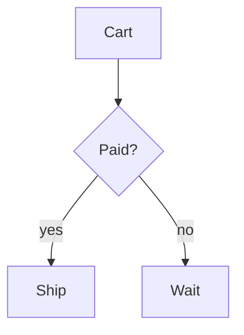

# Documenting your code

Doctize reads the Javadoc you already write. You decide *which* elements are published with three
annotations, and *how* they read with ordinary comments.

## The annotations

| Annotation | Put it on | Effect |
|------------|-----------|--------|
| {@link Doc} | a type | An **API page**: signature, description and all public and protected members. |
| {@link DocPage} | a package (`package-info.java`) or a type | A **prose page**: the comment *is* the page, there is no member listing. |
| {@link DocIgnore} | a member or a nested type | Hides it from the reference. |

`@Doc` and `@DocPage` share the placement attributes `section`, `title`, `order`, `group` and `keywords`:

```java
@Doc(section = "Caching", title = "Cache", order = 1, group = "Core", keywords = {"memoize", "lookup"})
public interface Cache<K, V> { /* ... */ }
```

- `section` is the id or the title of a [section](02-structuring-the-site.md). Without it the type goes to the
  API section (`API Reference` by default).
- `order` sorts pages, lower first. Pages of a group stay together and groups are ordered by their lowest `order`; see
  [How pages are ordered](02-structuring-the-site.md#how-pages-are-ordered). The default is 100.
- `group` becomes a small label in the navigation that keeps related pages together. For API pages it defaults to the
  package name.
- `keywords` are extra words that find the page through search, such as synonyms.

### Members and nested types

A `@Doc` type lists its `public` and `protected` members, and every member of an interface. Members the
compiler generates (`values()` and `valueOf` of enums, the accessors and `equals`/`hashCode`/`toString`
of records) are left out unless you gave them a comment. Use `@Doc(members = false)` to publish the type alone.

Nested types appear in a "Nested types" group of their owner's page with their signature and description. To
give one a page of its own, with all its members, annotate it as well:

```java
public final class Doctize {

    @Doc(title = "Doctize.Builder")
    public static final class Builder { /* ... */ }
}
```

### Prose pages

`@DocPage` is for text that belongs next to the code, such as a concept explained in `package-info.java`:

```java title="package-info.java"
/// # Choosing an eviction policy
///
/// A bounded cache must decide what to throw away when it is full ...
@DocPage(section = "Guides", order = 10)
package com.acme.cache;
```

A leading `# Heading` becomes the page title.

## Two comment styles

Both styles are read as Markdown. Classic HTML Javadoc keeps working, because Markdown passes HTML through.

```java tab="Markdown (JEP 467)"
/// Returns the value for a key.
///
/// - Loads it if it is missing
/// - Never returns `null`
///
/// @param key the key
/// @return the value
V get(K key);
```

```java tab="Classic"
/**
 * Returns the value for a key.
 *
 * <ul>
 *   <li>Loads it if it is missing
 *   <li>Never returns {@code null}
 * </ul>
 *
 * @param key the key
 * @return the value
 */
V get(K key);
```

The first sentence of a type's comment is its summary, used as the page description that search engines and
link previews show. End it with a period; `e.g.` and periods inside `{@link}` or code do not count as the end.

## Block tags

| Tag | Where it appears |
|-----|------------------|
| `@param name text` | A parameter table. Type parameters (`@param <T>`) and record components are shown too. |
| `@return text` | A "Returns" block with the return type. |
| `@throws Type text`, `@exception` | A "Throws" block. |
| `@deprecated text` | A warning below the heading. A type annotated with `@Deprecated` is also struck through in the navigation. |
| `@see reference` | A "See also" list. Accepts a reference, a `"quoted title"` or an HTML link. |
| any other tag: `@since`, `@apiNote`, `@author`, your own | A labelled block. `@apiNote` shows as "API note", `@myTag` as "My tag". |

A parameter table is shown when at least one parameter of the member is documented.

## Inline tags and links

| Written as | Result |
|------------|--------|
| `{@code text}` | inline code; braces must be balanced |
| `{@literal text}` | the text, with no markup interpreted |
| `{@link Type}` | a link to a documented type, labelled with code |
| `{@link Type#member(Arg)}` | a link to a member, e.g. `{@link Cache#get(Object)}` |
| `{@link #member}` | a member of the type you are in |
| `{@linkplain Type label}` | the same, with a plain label |
| `{@summary text}` | sets the summary explicitly |
| `{@snippet : code}` | an example: a highlighted code block, inline or from a file, see [Examples](#examples-with-snippet) |

A reference is resolved against every documented type: by simple name (`Cache`), qualified name
(`com.acme.Cache`), or `Outer.Inner`. When it cannot be resolved, only the label is shown, so a link to a
type outside your documentation degrades to plain code instead of breaking.

In Markdown comments you can also use the reference links of JEP 467: `[Cache]`, `[Cache#get(Object)]` and
`[the cache][Cache]`. Brackets that do not name a documented element stay ordinary Markdown.

Inside a method reference, a type variable such as `K` is written as `Object`, exactly as in Javadoc:
`{@link Cache#put(Object, Object)}`.

Inline tags are not interpreted inside code spans and fenced code blocks, so you can show them literally.

## Examples with `@snippet`

`{@snippet}` (JEP 413) shows an example as a highlighted code block with a copy button. The code follows a colon:

```java
/**
 * Creates a cache.
 *
 * {@snippet :
 * Cache<String, User> users = Cache.builder()   // @highlight substring="builder"
 *         .maximumSize(1_000)
 *         .build();
 * }
 */
```

The language is Java unless `lang` says otherwise: `{@snippet lang=yaml : ...}`.

### Markup comments

Comments starting with `@highlight`, `@replace`, `@link`, `@start` or `@end` change what is shown and are removed
from it. A comment applies to its own line, to the next line if it ends with a colon, or, with `region`, to all lines
up to the matching `// @end`. Use `#` instead of `//` in languages such as YAML or properties.

| Markup | Effect |
|--------|--------|
| `// @highlight` | the line in bold; `substring="..."` or `regex="..."` for part of it, `type=italic` or `type=highlighted` for another style |
| `// @replace regex='".*"' replacement='"..."'` | shows the line with the replacement, e.g. to hide a value |
| `// @link substring="Cache" target="Cache#get(Object)"` | links the text to a documented type or member, like `{@link}` |
| `// @highlight region` ... `// @end` | applies to all lines in between |
| `// @start region=setup` ... `// @end` | names a region of an external file, see below |

### Examples from files

Keep longer examples in real source files, where the compiler checks them, and show them with `file` or `class`:

```java
/** {@snippet file="Usage.java" region="setup"} */
/** {@snippet class=com.acme.examples.CacheExample} */
```

`region` shows only the lines from `// @start region=setup` to its `// @end`. The language follows from the file extension.

The annotation processor reads the files while compiling, from these places:

1. the `snippet-files` directory next to the source file, e.g. `src/main/java/com/acme/snippet-files/Usage.java`
2. the directories of the processor option `doctize.snippetPath` (separated like a class path), where `class=com.acme.Example`
   stands for `com/acme/Example.java`

Examples in your test sources are compiled and can run as tests. With Gradle:

```kotlin title="build.gradle.kts"
tasks.compileJava {
    options.compilerArgs.add("-Adoctize.snippetPath=${file("src/test/java")}")
    inputs.dir("src/test/java")   // recompile, and so update the docs, when an example changes
}
```

Give the option absolute paths, as above: the compiler may not run in the project directory. Gradle compiles
every `.java` file under `src/main/java`, `snippet-files` included, so either keep examples in a snippet path or
exclude them with `sourceSets.main { java.exclude("**/snippet-files/**") }`.

A file or region that cannot be found is a warning, both when compiling and when generating the site.

## Markdown features

Comments and guides share one renderer, which supports GitHub-flavoured Markdown:

- tables, task lists (`- [x] done`), strikethrough, autolinks
- **alerts**: `> [!NOTE]`, `> [!TIP]`, `> [!IMPORTANT]`, `> [!WARNING]` and `> [!CAUTION]`, see below
- **highlighted code blocks**: Java, Kotlin, Groovy/Gradle, JavaScript/TypeScript, JSON, YAML, properties, TOML,
  shell and XML/HTML. The highlighting is done at build time, so it needs no JavaScript.
- a **title** for a code block: `` ```java title="Main.java" ``
- **tabs**: consecutive fenced blocks with a `tab` attribute become one tab group. The reader's choice is
  remembered and applied to every tab group with the same label.

  ````markdown
  ```groovy tab="Gradle"
  implementation 'dev.acme:cache:1.0'
  ```

  ```xml tab="Maven"
  <dependency>...</dependency>
  ```
  ````

- **diagrams**: a fenced block with the language `mermaid` is a [Mermaid](https://mermaid.js.org) diagram, see below
- `<pre>{@code ...}</pre>` blocks in classic comments are turned into highlighted code blocks with a copy button.
- Headings get permalink anchors, and the "On this page" navigation lists the second and third level headings.

### Alerts

An alert is a block quote whose first line names its type:

```markdown
> [!TIP]
> Prefer `getOrLoad` over `get` followed by `put`.
```

> [!TIP]
> Prefer `getOrLoad` over `get` followed by `put`.

Alerts are recognised at the top level of a comment or guide. Inside a list item or another quote they are
shown as an ordinary block quote.

### Diagrams

Write a diagram as text, and the browser draws it: flow charts, sequence diagrams, class diagrams, state diagrams, entity-relationship
diagrams, Gantt charts and everything else that Mermaid knows.

````markdown

````


The Mermaid library is copied into the site, only if a page has a diagram, and a page only loads it if it shows one. So diagrams
work offline and from the file system, and follow the light and dark mode of the site. With scripts off, the text of the diagram is shown.

## Keep in mind

- Javadoc tags and Markdown share the `@` character: a line that *starts* with `@Something` is read as a
  block tag, unless it is inside a fenced code block or a `<pre>` element.
- `{@inheritDoc}` is dropped, not resolved from the supertype.
