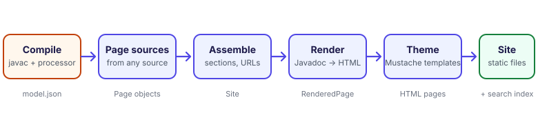

# How it works



Doctize is a pipeline of small, separate steps. Knowing them helps when something does not come out as you
expected, and shows where to plug in your own code.

## 1. Compile: the annotation processor

`DocProcessor` runs inside `javac`. It finds every element annotated with {@link Doc} or {@link DocPage} and
records what it needs: names, the declaration as source text, parameters, annotations, the **raw** doc comment
and the placement you asked for. At the end of compilation it writes one file, `META-INF/doctize/model.json`, into
your class output directory. Nothing is rendered at compile time.

```json title="model.json (abridged)"
{
  "formatVersion": 1,
  "elements": [
    {
      "role": "API",
      "declaration": {
        "kind": "CLASS",
        "name": "Store",
        "qualifiedName": "com.acme.Store",
        "packageName": "com.acme",
        "signature": "public class Store",
        "annotations": [],
        "parameters": [],
        "thrownTypes": []
      },
      "comment": "A store.\n\n@since 1.0",
      "placement": { "section": "", "title": "", "order": 100, "group": "" },
      "keywords": [],
      "members": [ /* one element per documented member */ ]
    }
  ]
}
```

Keeping the comment *raw* is deliberate: Javadoc parsing, Markdown and link resolution happen later, in the
generator, so improving them never requires recompiling your code. The file is a plain, versioned hand-over format,
described by {@link SourceModel}.

## 2. Page sources

The generator turns the model, and the guides directory, into {@link Page}s through {@link PageSource}s.

- The API source creates a page per `@Doc` type and a guide page per `@DocPage` element.
- The guides source creates a page per Markdown file, reading its front matter and folder.
- Any {@link PageSource} you register adds more.

A page says *what* it wants (a section, an order, a title) but not *where* it ends up.

## 3. Assemble

The `SiteAssembler` resolves each page's section against the configured structure, creates sections that
pages mention but nobody declared, orders the pages, gives them unique URLs and drops empty sections. The result
is a `Site`: sections in navigation order, each with its pages. This is the only place that knows the
structure, which is why changing it never touches the other steps.

## 4. Render

Each page is rendered independently, in one of two ways:

| Page | Steps |
|------|-------|
| Guide or prose page | Javadoc inline tags → Markdown → HTML. Headings get ids, code is highlighted, relative links are rewritten. |
| API page | The comment is parsed into a description and block tags. Signature, parameters, return value and tags are prepared as view objects; every text goes through the same tag and Markdown steps. |

Link resolution uses an index of all documented types and members, built from the assembled site, so a
`{@link}` works across pages and even across modules. Along the way, every page also yields its **table of
contents** (its headings) and its **plain text split at headings** (for search).

## 5. Theme

The view objects are given to the theme's [Mustache templates](04-template-reference.md): first the page body, then
the `layout` around it, with the navigation, the "On this page" list and the previous and next links. The theme is a
stack of layers, a custom directory over the built-in theme, so every file is looked up top-down.

## 6. Write

The result is static:

```text
build/docs/
  index.html
  search-index.js            all searchable text, as a script
  quick-start/quick-start.html
  guides/...
  api/dev.doctize.Doctize.html
  assets/
    css/theme.css            from the theme
    js/*.js                  search and page behaviour
    content/images/...       files from the guides directory
    custom/...               your extraCss and extraJs
  .doctize-site              marks the directory as generated, so that it may be cleaned
```

## Design decisions

- **Static and relative.** No server, no build step for readers, no absolute URLs. The site works from disk, from any
  sub-path, and from any host.
- **Structure is data, not code.** Placement is declared by pages, and decided in one place.
- **Text is Markdown; tags are inline HTML.** Inline tags such as `{@code}` produce HTML with character references,
  which reads correctly both in Markdown paragraphs and in the raw HTML blocks of classic Javadoc (`<p>...`).
- **Search runs in the browser.** No service, no account; the cost is that the index is loaded with the page.
- **Highlighting at build time.** Code is readable even with scripts disabled, and pages do not jump when a
  highlighter finishes.
- **This site is its own test.** It is generated from Doctize's sources on every release, so a regression in
  the pipeline shows up in the documentation first.
