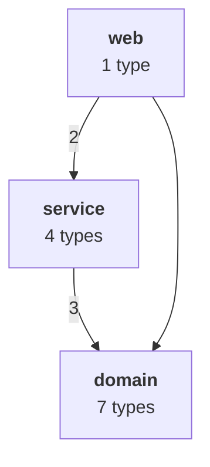
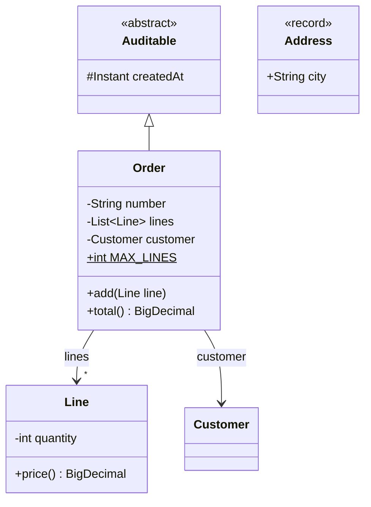
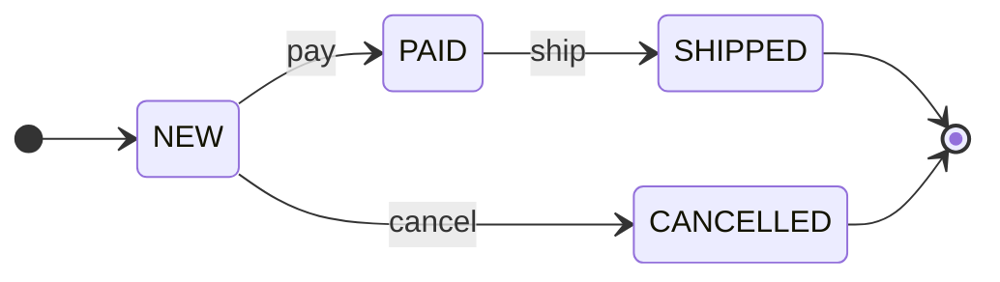
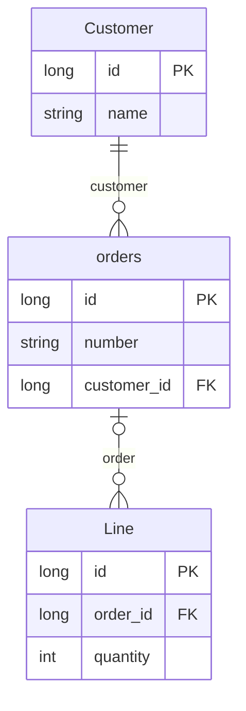
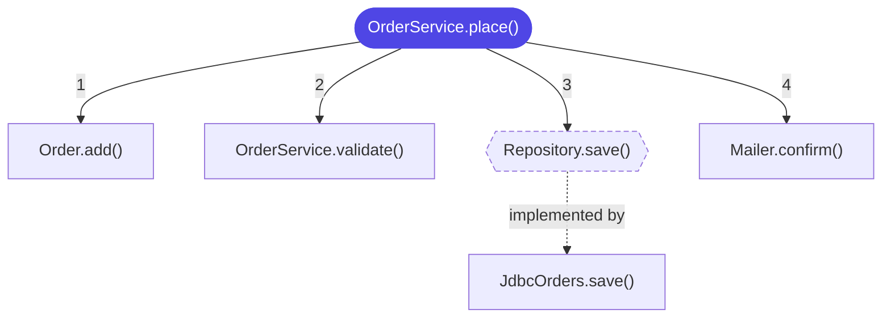

# Architecture diagrams

The API reference says what each type does. Architecture diagrams answer the questions it cannot: *how is this project put together, what
does its data look like, which states can an order be in, what happens when a customer checks out?* Doctize reads the compiled classes
and draws five kinds of [Mermaid](https://mermaid.js.org) diagram, each on a page of its own:

| Kind | Shows | Made from |
|------|-------|-----------|
| `overview` | The packages, or components, of the project and how they depend on each other; cycles, layers and rules | The class files |
| `classes` | Types, their fields and methods, and how they relate | The class files |
| `states` | The states of a state machine and the transitions between them | `@StateMachine` and `@Transition` |
| `entities` | The database model: entities, columns, keys and relations | Persistence annotations (JPA, by default) |
| `flows` | What a method calls, and what those call, in the order of the calls | `@Flow`, or entry points you name |

> [!IMPORTANT]
> Architecture diagrams are a **Pro feature**: they need a Doctize Pro license, which you buy, see [Licensing](../setup/06-licensing.md).
> Without one, Doctize skips them with a warning, and everything else is generated as usual. Writing a Mermaid diagram by hand in a
> guide is free, see [Documenting your code](01-writing-documentation.md).

The diagrams are Mermaid, so the source of every diagram is in the page, readable and copyable, and the browser draws it. The
Mermaid library ships with Doctize and is copied to the site, so the diagrams also work offline and from the file system. They follow the
light and dark mode of the site.

## Switch it on

Architecture diagrams are off until you ask for them. In `doctize.yml`:

```yaml title="doctize.yml"
architecture:
  enabled: true          # the overview, which is on unless you switch it off
  diagrams:
    classes: true
    states: true
    entities: true
    flows: true
```

Every kind has its own switch, and its own options. A kind is written as `true` or `false`, or as a mapping of options, which switches
it on unless it says `enabled: false`. A kind that is not mentioned is on for the overview and off for the others. On the command line and
in Gradle:

```console
$ doctize generate --diagram classes --diagram flows      # implies --architecture
```

```kotlin title="build.gradle.kts"
doctize {
    diagrams = listOf("classes", "flows")
}
```

Doctize analyzes the class directories and jars you already give it with `--model`. Give more with `--classes`, for example for modules
that have nothing to document, and therefore no model. The Gradle plugin passes the classes of the project. Every enabled kind adds a page
to a section of its own, *Architecture*, which is a header in the navigation next to the others; the settings `title`, `section` and `order`
are described below.

## How the diagrams are made

Doctize reads class files, not source, so it sees what the compiler saw. That has consequences worth knowing:

- **Parameter names** are only in the class file if the code was compiled with `-parameters`. Without it, diagrams show `pay(Money)` and not
  `pay(Money amount)`.
- **Generic types** are read from the signatures the compiler keeps, so `List<Order>` is drawn as such.
- **What only exists at run time** is invisible: reflection, class names in strings, service loaders, and wiring done by a framework.
  Constants of another class are copied into the code by the compiler, and annotations with source retention such as {@link Doc} leave
  no trace. A diagram shows what the code requires to compile and link.
- **Nested types** are drawn as `Outer.Inner`. Anonymous classes, lambdas and compiler-made members are never shown.

## Marking code parts

Class files say a lot, but not what matters. Five annotations let you say so: which parts to leave out, which to make sure are shown, and
the things that no class file can tell, such as what a state change is.

| Annotation | On | Meaning |
|------------|----|---------|
| {@link DiagramIgnore} | types, methods, constructors, fields, packages | Keeps it out of the diagrams, of all kinds or of the ones named in `types` |
| {@link DiagramInclude} | types, methods, constructors, fields, packages | Makes sure it is shown, whatever the configuration leaves out. With `types = DiagramTypes.ENTITIES` on a class: it is an entity |
| {@link StateMachine} | enums | The constants are the states of a state machine |
| {@link Transition} | enum constants, methods | A change from one state to another. Repeatable |
| {@link Flow} | methods | The start of a flow chart |

Add the annotations to your build as a `compileOnly` dependency, next to the processor if you use it. The Gradle plugin does that for you:

```kotlin
dependencies {
    compileOnly("dev.doctize:doctize-annotations:0.1.0")
}
```

> [!NOTE]
> Unlike {@link Doc}, these annotations are kept in the class file, because the diagrams are made from class files. The JVM ignores an
> annotation whose class it cannot find, so they are not needed at run time. Compiling *against* a library that uses them, without the
> annotations on the class path, is fine as well; only a build that compiles with `-Xlint:all` shows `[classfile]` notes for
> annotations that carry values (`types = ...`, `name = ...`), which `-Xlint:-classfile` switches off. That is also why `types` takes text
> and not an enum: use the constants of {@link DiagramTypes}.

### Ignore and include

```java title="Order.java"
public class Order {

    @DiagramIgnore                                   // in no diagram
    private String internalNote;

    @DiagramIgnore(types = DiagramTypes.FLOWS)       // in every diagram but flow charts
    void audit() { }

    @DiagramInclude                                  // shown although it is private
    private void reprice() { }
}

@DiagramIgnore                                       // a type, with everything in it, and nested types
class Scratch { }
```

```java title="package-info.java"
@DiagramIgnore                                       // all types of the package
package com.acme.generated;
```

What a mark means depends on the kind of diagram:

| Kind | `@DiagramIgnore` | `@DiagramInclude` |
|------|------------------|-------------------|
| overview | The type is not analyzed: it is no part of a package, and none of its dependencies count | The type is analyzed although its package is excluded |
| classes | The type, or the member, is not drawn, and neither is a relation that comes from it | The type is drawn although it is excluded; a member although it is less visible than `methodVisibility` or `fieldVisibility`, or an accessor |
| states | An enum, a constant (state) or a method (transition) is left out | The enum is drawn although it is excluded |
| entities | The class, or the field (column), is left out | The class is an entity, even without a persistence annotation |
| flows | The method is not followed, and neither is a type | The method or type is followed although it is excluded |

Which mark wins is decided in this order, and the first that applies is used:

1. the mark on the type or member itself. If it has both, **the ignore wins**,
2. the mark on the type it is nested in,
3. the mark on its package,
4. the configuration: `rootPackage`, `include`, `exclude` and the include and exclude patterns of the kind of diagram.

A mark on a type therefore beats a mark on its package, and both beat the configuration. Where a kind has `onlyMarked: true`, only what
is marked with {@link DiagramInclude} is shown.

### State machines

Mark an enum with {@link StateMachine}, and say what leads from one state to another with {@link Transition}. On an enum constant the
transition starts at that constant:

```java title="OrderState.java"
@StateMachine(name = "Order lifecycle", initial = "NEW", terminal = {"SHIPPED", "CANCELLED"},
              description = "What can happen to an order.")
public enum OrderState {
    @Transition(to = "PAID", on = "pay")
    @Transition(to = "CANCELLED", on = "cancel")
    NEW,

    @Transition(to = "SHIPPED", on = "ship")
    PAID,

    SHIPPED,
    CANCELLED
}
```

On a method, the transition names the states it can be called in, and the enum, unless the method is in the enum itself. `"*"` means
every state that is not terminal and not the target:

```java title="OrderService.java"
@Transition(from = {"NEW", "PAID"}, to = "CANCELLED", on = "expire", machine = OrderState.class)
public void expire(Order order) { ... }

@Transition(from = "*", to = "CANCELLED", on = "fraud", machine = OrderState.class)
public void markFraud(Order order) { ... }
```

The same change declared twice, on the constant and on the method, is drawn once and listed twice. Mistakes in the annotations are
warnings that say what to do: a state that is no constant, a method without `from`, a `machine` that is not a state machine.

### Flows

Mark the method a flow starts at with {@link Flow}, or name entry points in the configuration:

```java
@Flow(name = "Place an order", description = "From the checkout button to the confirmation mail.")
public Order place(Customer customer, List<Line> lines) { ... }
```

## The overview

The overview is the map of the project: a box for every package (or component), an arrow for every dependency, and next to it tables,
dependency cycles, layers and rules. A class **depends on** another if its class file mentions it: as super type,
in a field, parameter, return type or generic type argument, in a `throws` clause, or in the code of a method.



- **Parts.** By default a part is a package. Packages can be merged with [`depth`](#depth) and gathered into named
  [`components`](#components).
- **Weight.** The number of *pairs of types* in which a type of one part refers to a type of the other, written on the arrow.
- **Direction.** An arrow points from a part to the parts it depends on. Parts that depend on others are drawn above them (or, with
  `direction: left-right`, to the left), so a healthy architecture reads from top to bottom.
- **Red** marks a part in a dependency cycle, and an arrow in a cycle or one that breaks a rule.
- **The JDK** is not a dependency. Other libraries are only listed if you ask, see [`external`](#external).

By default the overview is drawn with Mermaid. With `diagrams.overview.format: svg` it is an SVG that Doctize draws itself, which needs
no script at all, and a site with only that gets no Mermaid library.

## Options

All options are optional and set under `architecture:` in `doctize.yml`; they map onto {@link ArchitectureSettings} and
{@link DiagramSettings}. Unknown keys are rejected, like everywhere in the [configuration](../setup/04-configuration.md).

### For all diagrams

| Key | Default | Meaning |
|-----|---------|---------|
| `enabled` | `false` | Switch the architecture diagrams on. Same as `--architecture`. |
| `title` | `Architecture` | The title of the overview page. |
| `section` | `Architecture` | The section the pages are in, by id or title. It is created if you did not declare it. |
| `order` | `100` | Where the overview is in its section; the other pages follow it. |
| [`rootPackage`](#root-package) | the package all packages share | Where the code starts. Only this package and the ones below it are shown. |
| [`include`](#include-and-exclude) | all | Only packages that match one of these patterns are shown. |
| [`exclude`](#include-and-exclude) | none | Packages that match one of these patterns are left out. |
| `diagrams` | the overview | The kinds of diagram, with their options, see below. |

`include`, `exclude` and `rootPackage` decide which packages every kind of diagram looks at, apart from what the marks say.

### The overview only

| Key | Default | Meaning |
|-----|---------|---------|
| `diagrams.overview` | `true` | `true`, `false`, or a mapping with `enabled`, `format` and `exclude`. |
| `diagrams.overview.format` | `mermaid` | `mermaid`, or `svg` for a diagram that needs no script. |
| `diagrams.overview.exclude` | none | Package patterns that are left out of the overview *only*, on top of `exclude` for all diagrams. The classes stay in the other diagrams. |
| [`depth`](#depth) | `0` | How many package levels below the root are shown separately; deeper packages are merged. `0` shows all. |
| [`components`](#components) | none | Named groups of packages, drawn as one box each. |
| [`layers`](#layers) | none | Parts or packages from the top of the architecture to the bottom. Dependencies pointing upwards are reported. |
| [`forbid`](#forbid) | none | Dependencies that must not exist. Each one that does is reported. |
| `cycles` | `true` | Find dependency cycles, mark them red and report them. |
| [`external`](#external) | `false` | List the libraries the code uses. |
| `libraryDepth` | `2` | How many package levels identify a library, see [`external`](#external). |
| `minReferences` | `1` | The least weight a dependency needs to be drawn. The tables always list all. |
| `direction` | `top-down` | `top-down` or `left-right`. |

### Package patterns

`include`, `exclude`, `components` and the rules take **package patterns**. A pattern is a package name where a segment can be

- exact: `com.acme.api` is that package only,
- `*` for any characters within a segment: `com.acme.*` is every direct sub-package of `com.acme`, `com.acme.*Impl` those ending in `Impl`,
- `**` for any number of segments, none included: `com.acme.api.**` is `com.acme.api` and everything below it, and `**.internal`
  every package called `internal`.

Patterns always match the full name. The include and exclude patterns of a kind of diagram, `includeTypes` and `excludeTypes`, work the
same way on the names of types: `com.acme.**.*Service`, and for a nested type `com.acme.Order.Line`.

### Root package

Names on the overview are relative to the root package, so `com.acme.billing.invoice` becomes `billing.invoice`. Doctize uses the longest
package name that all packages share. Set `rootPackage` to start deeper, and to leave everything outside it out:

```yaml
architecture:
  rootPackage: com.acme.billing
```

### Depth

A large project has too many packages for one overview. With `depth`, packages deeper than that many levels below the root are merged into
their ancestor at that level:

```yaml
architecture:
  rootPackage: com.acme
  depth: 1        # com.acme.billing.invoice and com.acme.billing.tax are shown as "billing"
```

### Include and exclude

```yaml
architecture:
  include: ["com.acme.**"]
  exclude: ["**.generated", "**.internal", "com.acme.testing.**"]
```

`exclude` wins over `include`. Excluded classes are left out of the diagrams, but Doctize still knows they belong to the project, so a
dependency on them is not listed as a library.

Excluding one exact package is often the fix for a noisy overview. Many projects have a facade or shared exception in their root package
that everything refers to and that refers to everything: a cycle through the root that hides the real structure. Doctize's own
overview excludes its root package this way:

```yaml
architecture:
  exclude: ["dev.doctize"]   # exactly this package, not the ones below it
```

### Components

A component gathers packages that belong together under one name, and one box:

```yaml
architecture:
  components:
    - name: Web
      packages: ["com.acme.web.**", "com.acme.api.**"]
      description: HTTP endpoints and their DTOs.
    - name: Business
      packages: [com.acme.domain, com.acme.service]
      description: The rules of the business.
    - name: Persistence
      packages: ["com.acme.jdbc.**"]
```

A package belongs to the first component that matches it, and packages that match none are shown on their own. Descriptions get their own
column in the table of parts. Component names are what [`layers`](#layers) and [`forbid`](#forbid) can refer to, and what class diagrams
can be grouped by.

### Layers

Declare the layers of your architecture from the top to the bottom. A part may depend on parts in its own layer and below; a dependency
that points upwards is a violation:

```yaml
architecture:
  components:
    - {name: Web, packages: ["com.acme.web.**"]}
    - {name: Business, packages: ["com.acme.domain.**", "com.acme.service.**"]}
    - {name: Persistence, packages: ["com.acme.jdbc.**"]}
  layers: [Web, Business, Persistence]
```

An entry is the name of a part, a component or a package as shown on the overview, or a package pattern. Parts in no layer are
unconstrained.

### Forbid

Where layers are too coarse, forbid single dependencies. `from` and `to` are package patterns or names of components:

```yaml
architecture:
  forbid:
    - from: com.acme.domain.**
      to: com.acme.jdbc.**
      reason: The domain must not know how it is stored.
    - from: Web
      to: Persistence
```

Every package pair that breaks a rule is reported with an example type pair and the reason.

### External

`external: true` adds a table of the libraries the code uses, which parts use them, and how often. A library is identified by the first
`libraryDepth` segments of its packages, `org.commonmark` with the default of 2. Use `3` to tell apart libraries that share the first two,
such as `com.fasterxml.jackson` from other `com.fasterxml` libraries.

## Class diagrams



There is one diagram for every package, so that each stays readable, and a package with more than `maxClasses` types is split into
parts. `+` is public, `#` protected, `~` package and `-` private. Interfaces, enums, records and abstract classes are labelled. A
relation is drawn for `extends` and `implements`, and for every field that holds another type of the project, labelled with the name of the
field and, for a collection, with `*`. Optionally methods count too: with `dependencies`, a parameter or return type is a relation
drawn with a dotted arrow.

```yaml
architecture:
  diagrams:
    classes:
      title: Class diagrams
      groupBy: package
      methodVisibility: public
      accessors: false
```

| Key | Default | Meaning |
|-----|---------|---------|
| `enabled` | `true` when mentioned | Draw class diagrams. |
| `title` | `Class diagrams` | The title of the page. |
| `groupBy` | `package` | What one diagram is drawn for: `package`, `component` (the [components](#components) of the configuration, and packages that are in none), or `all`. |
| `maxClasses` | `30` | The most types in one diagram. A larger group is split into parts. |
| `fields` | `true` | Show fields. Enum constants and the components of a record are always shown with them. |
| `fieldVisibility` | `private` | The least visible fields that are shown: `private`, `package`, `protected` or `public`. |
| `methods` | `true` | Show methods. |
| `methodVisibility` | `public` | The least visible methods that are shown. |
| `constructors` | `false` | Show constructors. |
| `accessors` | `false` | Show getters, setters, record accessors, `equals`, `hashCode` and `toString`. |
| `stereotypes` | `true` | Label interfaces, enums, records and abstract classes. |
| `inheritance` | `true` | Draw `extends` and `implements`. |
| `associations` | `true` | Draw fields that hold other types of the project as relations. |
| `dependencies` | `false` | Draw parameters, return types and exceptions of methods as relations. |
| `neighbours` | `false` | Also draw, as boxes without members, the types of other diagrams that the types of this one relate to. |
| `onlyMarked` | `false` | Draw only what is marked with `@DiagramInclude`. |
| `includeTypes` | all | Only types that match one of these patterns are drawn. |
| `excludeTypes` | none | Types that match one of these patterns are left out. |
| `direction` | `top-down` | `top-down` or `left-right`. |

An annotation type is only drawn if you mark it with `@DiagramInclude`. A member marked with `@DiagramInclude` is shown whatever its
visibility, and one marked with `@DiagramIgnore` is not, and neither is the relation that comes from it.

## State diagrams



There is one diagram for every enum marked with {@link StateMachine}. Below it are the states, and the transitions with the place where each
is declared, so that the page can be searched. Doctize also points out states that no transition enters or leaves, which are often a
forgotten annotation.

| Key | Default | Meaning |
|-----|---------|---------|
| `enabled` | `true` when mentioned | Draw state diagrams. |
| `title` | `State diagrams` | The title of the page. |
| `events` | `true` | Write what causes a change on the arrow. |
| `direction` | `left-right` | `top-down` or `left-right`. |
| `includeTypes` | all | Only enums that match one of these patterns are drawn. |
| `excludeTypes` | none | Enums that match one of these patterns are left out. |

## Entity-relationship diagrams



Entities are the classes annotated with `jakarta.persistence.Entity` or `javax.persistence.Entity`, and the classes marked with
`@DiagramInclude(types = DiagramTypes.ENTITIES)`, which is how you draw a model that has no persistence annotations. Their fields are the
columns, apart from `@Transient` and `transient` fields. Fields of a `@MappedSuperclass` are columns of the entity, and an
`@Embedded` field is one column that has the name of its type. A field that leads to another entity is a relation: `@OneToMany`, `@ManyToOne`,
`@OneToOne`, `@ManyToMany`, or, without an annotation, a field of the type of an entity, or a collection of them. A relation that is
declared on both sides is drawn once, with the name of the side that owns it. The side that owns a many-to-one or one-to-one relation
gets a foreign key column.

Java types are drawn as short database types: `string`, `int`, `long`, `boolean`, `double`, `decimal`, `date`, `time`, `timestamp`, `uuid`,
`blob`, `enum` and `list`; the name of any other type is used as it is.

| Key | Default | Meaning |
|-----|---------|---------|
| `enabled` | `true` when mentioned | Draw the entity-relationship diagram. |
| `title` | `Data model` | The title of the page. |
| `columns` | `true` | Show the columns of every entity. |
| `keys` | `true` | Mark primary keys (`PK`) and foreign keys (`FK`). |
| `relationships` | `true` | Draw the relations between entities. |
| `tableNames` | `false` | Use the names of `@Table(name = ...)`, `@Column(name = ...)` and `@JoinColumn(name = ...)` where there are any, instead of the names in the code. |
| `entityAnnotations` | JPA `Entity`, both packages | The annotations that make a class an entity, by full name. Use it for other mapping libraries. |
| `idAnnotations` | JPA `Id` and `EmbeddedId`, both packages | The annotations that make a field a primary key. |
| `onlyMarked` | `false` | Draw only classes marked with `@DiagramInclude`. |
| `includeTypes` | all | Only entities that match one of these patterns are drawn. |
| `excludeTypes` | none | Entities that match one of these patterns are left out. |

```yaml
architecture:
  diagrams:
    entities:
      tableNames: true
      entityAnnotations: [io.micronaut.data.annotation.MappedEntity]
      idAnnotations: [io.micronaut.data.annotation.Id]
```

## Flow charts



A flow chart starts at a method and follows its calls in the order the calls are in the code, down to `depth` levels. The number on an
arrow is the position of the call. The code of a lambda, and a method reference, count as part of the method they are in. A call of an
interface or abstract method is drawn as a hexagon, and, with `implementations`, continues in the classes that implement it, also when
the interface is generic.

What a class file has is calls, not decisions. A chart shows what a method **can** call, in the order the code says so, and not under which
condition. Methods of the JDK and of other libraries are not followed. A method with further calls that were cut off by `depth` is marked
with `…`.

| Key | Default | Meaning |
|-----|---------|---------|
| `enabled` | `true` when mentioned | Draw flow charts. |
| `title` | `Flows` | The title of the page. |
| `depth` | `4` | How many calls deep a flow is followed. |
| `maxNodes` | `40` | The most methods in one chart. A larger flow is cut off, and says so. |
| `implementations` | `true` | Continue in the implementations of an interface method. |
| `constructors` | `false` | Show creating objects as a step. |
| `accessors` | `false` | Show calls of getters and setters. |
| `numbered` | `true` | Number the arrows in the order of the calls. |
| `direction` | `top-down` | `top-down` or `left-right`. |
| `entryPoints` | none | Methods that start a flow in addition to those marked with `@Flow`, written `Type#method`, both as patterns: `com.acme.web.*Controller#*`. Each is a string, or a mapping with `method`, `name`, `description` and `depth`, see below. |
| `includeTypes` | all | Only methods of types that match one of these patterns are followed. |
| `excludeTypes` | none | Methods of types that match one of these patterns are not followed. |

```yaml
architecture:
  diagrams:
    flows:
      depth: 5
      entryPoints:
        - com.acme.web.*Controller#*                # a string: one flow per method that matches
        - method: com.acme.jobs.Nightly#run         # a mapping: with a title, a description and its own depth
          name: The nightly job
          description: Runs while everybody sleeps.
          depth: 2
      excludeTypes: ["**.logging.**"]
```

An entry point in the configuration needs no annotation, which is the way to draw the flows of code that must not carry one, for
example because it is compiled with `-Xlint:all -Werror` and does not have the annotations on its class path. The `depth` of an entry point
replaces the `depth` of the flows for that chart: a method that calls many others is clearest one level deep, and a flow through many layers
needs more.

## Cycles and rules in the build

Cycles and broken rules are **warnings**, one per cycle and per violation, and so are problems in the annotations and a kind of diagram
that is on but has nothing to show:

```console
doctize: warning: Architecture: dependency cycle between config, hosting, site.
doctize: warning: Architecture: com.acme.domain must not depend on com.acme.jdbc (e.g. Order → Database): The domain must not know how it is stored.
doctize: warning: @Transition on OrderService#expire needs machine = <an enum marked with @StateMachine>, but the class it is in is none.
doctize: warning: Flow charts are switched on, but there is no method to start from. Mark one with @Flow, or name entry points in flows.entryPoints.
```

With `--fail-on-warnings` (`failOnWarnings = true` in Gradle) they fail the build. That makes the diagrams a guard: architecture rules that
are checked on every build, and documented on the site they protect. If you only want to look at cycles, `cycles: false` turns the check
off; the rules you declare are always checked.

## Doing it in code

```java
Doctize.builder()
        .configFile(Path.of("doctize.yml"))
        .model(Path.of("build/classes/java/main"))
        .classes(Path.of("other-module/build/classes/java/main"))
        .diagram(DiagramSettings.Kind.CLASSES)
        .diagram(DiagramSettings.Kind.FLOWS)
        .license(Path.of("doctize.license"))
        .output(Path.of("build/docs"))
        .build()
        .generate();
```

{@link ArchitecturePageSource} is the page source behind it, and {@link ArchitectureAnalyzer} the analysis of the overview, which returns an
{@link ArchitectureModel} you can use for something else, such as a test that fails when a rule is broken.
